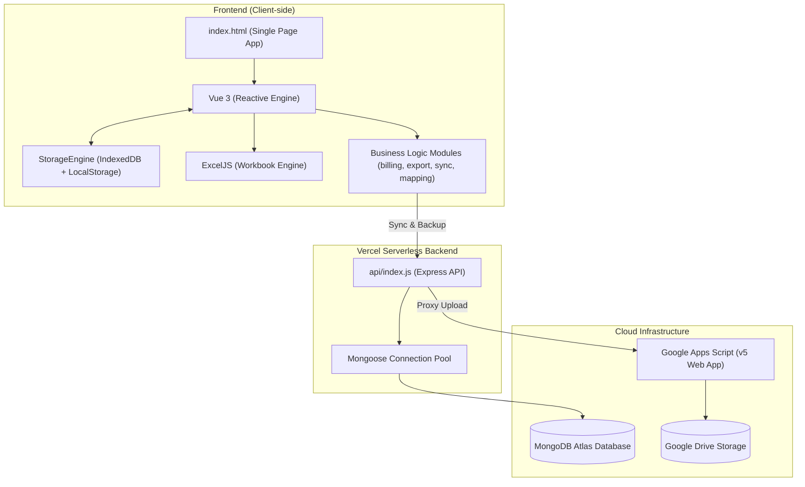

# ⚡ Billing Pro — RDSS T-10 GADCHIROLI

> Professional Electrical Engineering Billing, Reconciliation & Tax Invoice Studio.

---

## 🏗️ Architecture Overview

Billing Pro is an **offline-first, cloud-synchronized** engineering billing platform specifically designed for the **RDSS T-10 Gadchiroli** project (Ashoka Buildcon Ltd. / MSEDCL / LK Electricals).



---

## 📁 Project Directory Structure

```text
e:\Rakesh\Billing\
├── api/                        # Backend REST API (Vercel Serverless)
│   └── index.js                # Express app, MongoDB connection, GDrive proxy
├── css/                        # Application Styling
│   └── style.css               # Dark-theme styles, tables, forms, print media
├── docs/                       # Project Documentation & Reference Files
│   └── reference-files/        # Work orders, sample workbooks, amendment PDFs
├── google-drive/               # Google Apps Script Cloud Integration
│   ├── BillingDriveWebApp.gs   # Apps Script Web App (Version 5, auto-overwrite)
│   └── README.md               # 1-minute Google Drive webhook setup guide
├── js/                         # Frontend Modular JavaScript
│   ├── core/
│   │   ├── app.js              # Vue app instance, computed properties, watchers
│   │   └── storage.js          # High-capacity IndexedDB + LocalStorage engine
│   ├── data/                   # Initial seeds & master catalog defaults
│   │   ├── default-activities.js
│   │   ├── default-companies.js
│   │   ├── default-contractors.js
│   │   ├── default-invoice.js
│   │   ├── default-master-abstract.js
│   │   └── default-sap-materials.js
│   ├── billing.js              # 85/10/5% math, AAAC divisor, invoice items sync
│   ├── export.js               # Styled multi-sheet ExcelJS workbook generator
│   ├── history.js              # Undo / Redo timeline manager
│   ├── mapping.js              # SAP ERP Material Code cross-mapping engine
│   ├── sync.js                 # MongoDB cloud sync & Saved Bills manager
│   ├── utils.js                # Currency, formatting, toasts, print tools
│   └── views.js                # UI tab switching, material search modal
├── test/                       # Automated Calculation Test Suite
│   └── calculations.test.js    # Unit tests for 85%, AAAC divisor, GST, sanitization
├── Reconciliation master/      # Embedded Master Reconciliation tool (iframe)
├── index.html                  # Main desktop SPA application
├── mobile.html                 # Mobile-optimized companion view
├── server.js                   # Local Express development server
├── vercel.json                 # Vercel deployment routes and cache headers
└── package.json                # Dependencies and test runner scripts
```

---

## 🚀 Quick Start (Local Development)

### Prerequisites
- Node.js (v18 or higher)
- npm

### 1. Install Dependencies
```bash
npm install
```

### 2. Configure Environment (`.env`)
Create a `.env` file in the root directory:
```env
MONGODB_URI=mongodb+srv://<username>:<password>@cluster.mongodb.net/billing_db
API_KEY=your_optional_secret_api_key
GDRIVE_WEBHOOK_URL=https://script.google.com/macros/s/AKfycbw495PuqtHzuCATbRHI3dgofeWKaMVyYrUhc0twCdf0EbaPwSlpA81i0ExHdny6MZQ/exec
PORT=3000
```

### 3. Run Development Server
```bash
npm start
```
Open [http://localhost:3000](http://localhost:3000) in your browser.

---

## 🧪 Running Automated Tests

Run the zero-dependency calculation test suite:
```bash
npm test
```
Tests verify:
- ✅ Stage Billing Percentages (85% Erection, 10% Testing, 5% Handover)
- ✅ Conductor Divisor Math (`Activity 907: AAAC Total ÷ 3150 = KM`)
- ✅ GST Precision (CGST 9% + SGST 9% vs IGST 18%)
- ✅ Invoice Sanitization (Auto-cleaning placeholder rows)
- ✅ Export Filename Formatting (`<Contractor>_RA-<No>.xlsx`)

---

## ☁️ Cloud Persistence Protocol

1. **Local High-Capacity Engine (`js/core/storage.js`):**
   - Uses browser **IndexedDB** (`BillingProDB`) for unlimited offline capacity.
   - Dual-writes to `localStorage` for instantaneous boot times without quota errors.
2. **MongoDB Atlas (`api/index.js`):**
   - Stores complete bill state with revision tracking.
   - Auto-syncs every 15 seconds or immediately upon changes.
3. **Google Drive Backup (Version 5):**
   - Saves formatted Excel workbooks directly to `RDSS T-10 GADCHIROLI / <Contractor> / <Contractor>_RA-<No>.xlsx`.
   - Automatically cleans older timestamped duplicate copies and overwrites the active bill file.

---

## 📄 License
Internal proprietary billing software for RDSS T-10 Gadchiroli project contractor infrastructure work.

