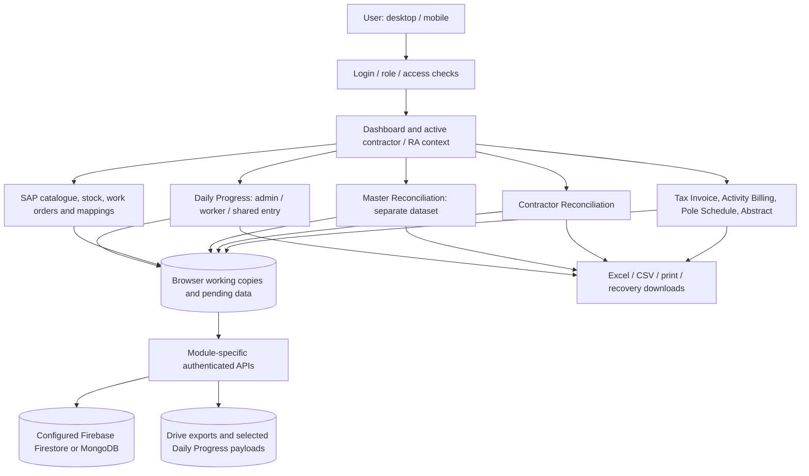
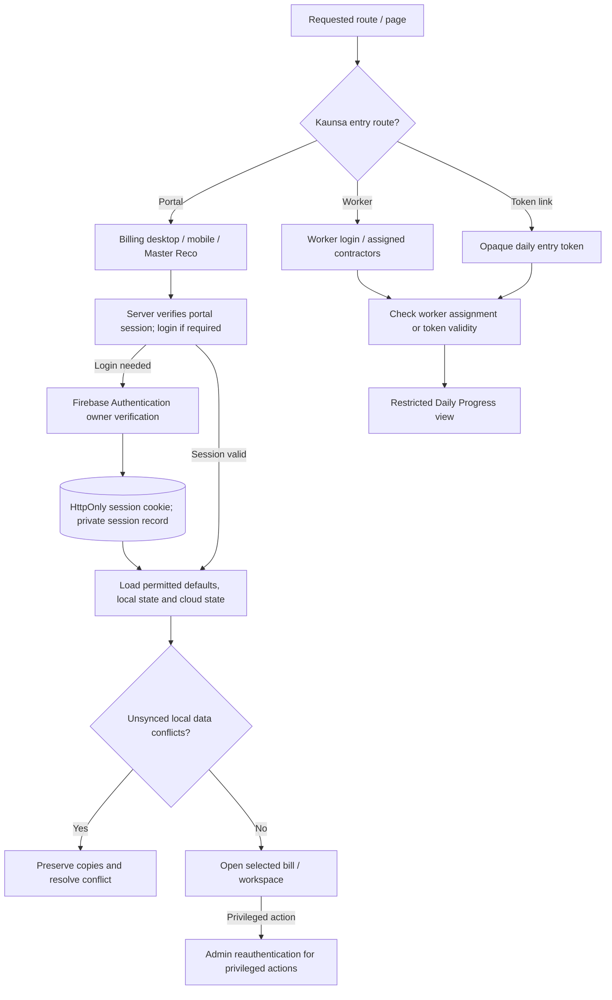
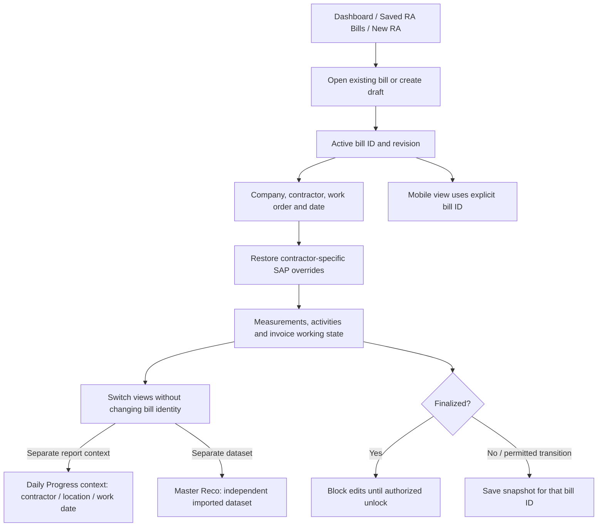
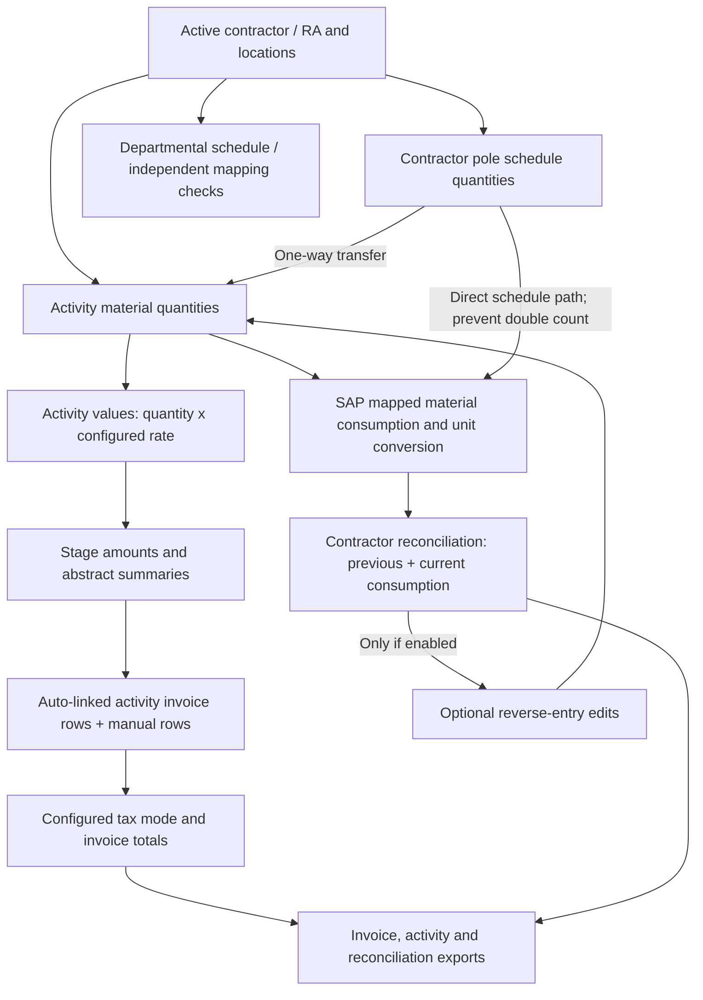
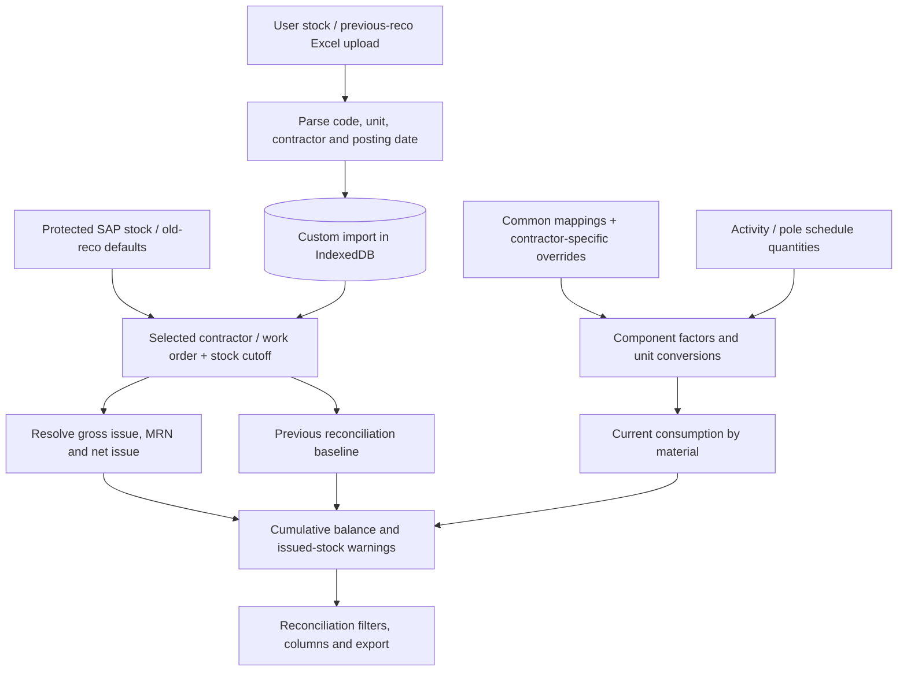
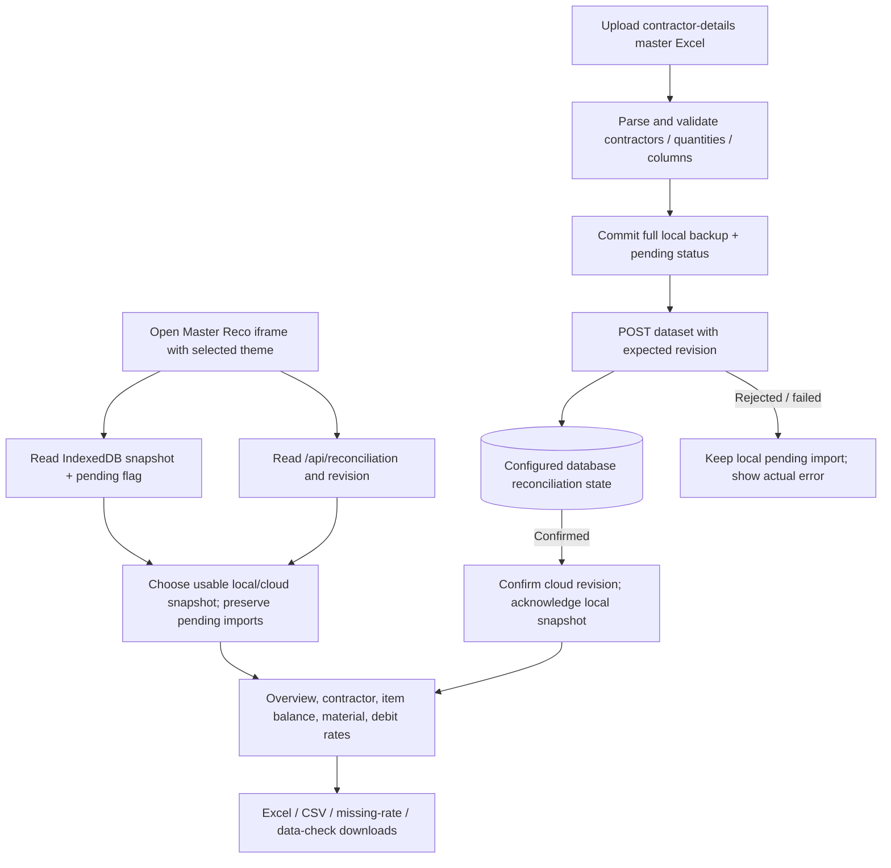
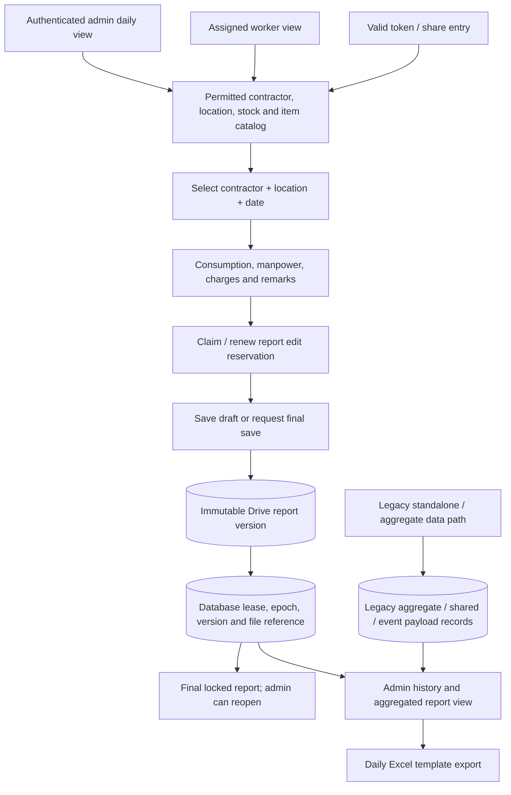
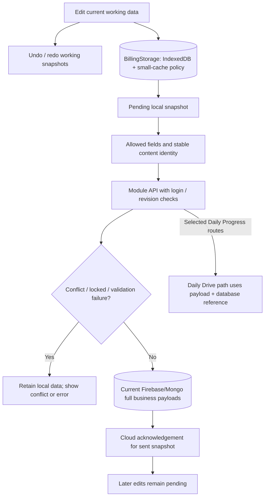
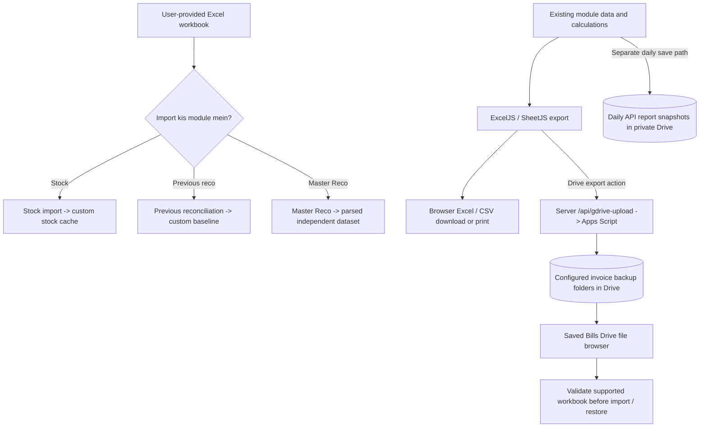
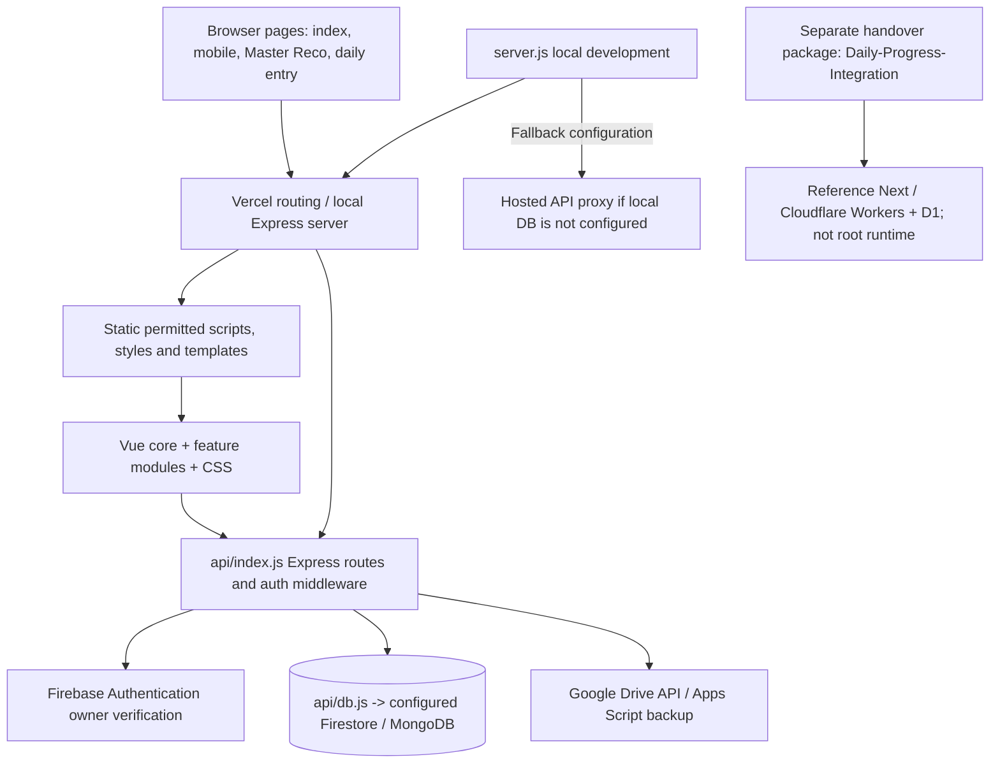

# Billing Pro - Complete Project Flowchart

Date: 18 November 2026 | Code baseline: `71418d4`

Charts 1-10 map current repository behavior. Proposed Drive-first architecture and its five detailed flows are in [the storage review](DRIVE_FIRST_FLOWCHART_REVIEW.md). This distinction prevents treating planned behavior as already deployed.

## Poore project ka overview

Current code: pages, business data aur storage ki boundaries.

- Sab pages ek hi dataset nahi hain. RA bill, Master Reco aur Daily Progress ke save flows alag hain.
- Neeche CURRENT charts existing code dikhate hain; baad ke PROPOSED charts future storage migration hain.

Source: `index.html`, `js/core/app.js`, `api/index.js`.

## Login, startup aur access

Portal login, worker login aur token links ek jaise access paths nahi hain.

- Owner login Firebase Authentication se verify hota hai; passwords billing database mein save nahi hote.
- Admin elevation structural/finalize/unlock actions ke liye alag check hai. Public catalog sanitized hai.

Source: `api/auth.js`, `api/daily-worker-auth.js`, `api/daily-progress-routes.js`, `js/core/app.js`.

## Navigation aur bill identity

Saved RA selection aur contractor identity calculation aur save target tay karte hain.

- Bill ID aur contractor ID preserve karna zaroori hai; sirf display name se records merge nahi karne.
- Daily Progress contractor context use kar sakta hai, lekin uski report key contractor + location + date hai.

Source: `js/sync.js`, `js/utils.js`, `js/billing.js`, `js/contractor-mapping.js`, `js/mobile.js`.

## Measurement se invoice aur reconciliation

Existing formulas aur one-way transfer ko storage change mein preserve karna hai.

- Pole Schedule -> Activity transfer one-way hai. Manual Activity entries Pole Schedule ko reverse overwrite nahi karti.
- Stage percentages configurable hain; defaults 85 / 10 / 5. GST/manual invoice-row behavior current rules se hi rahega.
- Departmental schedules contractor reconciliation se explicitly unlinked hain. Reverse-entry option limited reconciliation-to-activity edits hai.

Source: `js/pole-schedule.js`, `js/billing.js`, `js/core/app.js`, `js/views.js`, `js/reco-units.js`.

## SAP stock, mapping aur previous reconciliation

Available stock aur consumption ka same contractor context hona chahiye.

- Custom stock aur custom previous reconciliation browser-local stores use karte hain; server migration browser-only files ko khud discover nahi kar sakta.
- Posting-date cutoff aur explicit stock zero ko legacy issue quantity replace nahi karni chahiye. Fixed manual reconciliation quantities reusable mapping profile ka hissa nahi hain.

Source: `js/stock-importer.js`, `js/billing.js`, `js/mapping.js`, `js/contractor-mapping.js`, `js/old-reco-importer.js`.

## Master Reconciliation ka complete flow

Separate iframe application; uploaded master workbook is its source dataset.

- Current source mein RA bill saves se Master Reco ko automatic live update karne ka connection nahi hai.
- Missing rates, mixed stock/consumption dates aur negative balances data-quality issues hain; migration inhe invent karke fix nahi karegi.

Source: `Reconciliation master/app.js`, `Reconciliation master/analytics.js`, `api/index.js`, `js/core/storage.js`.

## Daily Progress aur shared entry

Daily reports aur RA bill quantities alag save paths hain.

- Report identity contractor + location + work date hai. Data entry, manpower, charges aur remarks report payload mein hain.
- Selected report paths Drive payload + database reference use karte hain. Legacy aggregate/shared/history paths abhi full business copies bhi rakhte hain.
- Daily Progress storage ko RA bill storage samajhkar merge karna ya automatic invoice quantity transfer add karna is plan ka hissa nahi hai.

Source: `js/daily-progress.js`, `js/daily-progress-standalone.js`, `api/daily-progress-service.js`, `api/daily-worker-auth.js`.

## Current local backup aur cloud sync

Current source behavior; proposed Drive-first policy abhi enabled nahi hai.

- Local-saved aur cloud-confirmed alag states hain. Master Reco ke large uploads ab localStorage ke bajay IndexedDB use karte hain.
- Bill saves snapshot identity / revision ke saath serialize hote hain; stale tabs ka conflict automatic overwrite ko rokta hai.
- Current billing Firestore revision check ko future migration ke liye final atomic commit mein strengthen karna baaki hai.

Source: `js/core/storage.js`, `js/sync.js`, `api/db.js`, `api/index.js`, `Reconciliation master/app.js`.

## Imports, exports aur Google Drive backups

Original files, editable state aur formatted exports ko ek cheez nahi maana gaya hai.

- Excel export browser mein generate hota hai; downloaded workbook automatically authoritative cloud dataset nahi ban jata.
- Invoice Drive export/file-browser Apps Script path aur Daily Progress Drive API path alag integrations hain.
- Master Reco ka current upload parsed data save karta hai; original source workbook ka separate Drive asset abhi proposed improvement hai.

Source: `js/export.js`, `js/stock-importer.js`, `js/old-reco-importer.js`, `js/sync.js`, `google-drive/BillingDriveWebApp.gs`.

## Runtime, API aur reference package boundaries

Root project aur handover package ko production ka ek hi runtime nahi dikhaya gaya hai.

- Root app Vue + Express/Vercel stack hai. Daily-Progress-Integration ek separate Next/Cloudflare D1 handover/reference package hai.
- Local server missing DB configuration mein hosted production API ko proxy kar sakta hai. Staging tests ke liye yeh fallback isolate/disable karna zaroori hai.
- Secrets server-side rahenge; private seed scripts authenticated route se serve hote hain.

Source: `server.js`, `vercel.json`, `api/index.js`, `js/core/app.js`, `Daily-Progress-Integration/README.md`.

## Third review - complete project coverage

1. Source mapping: portal/mobile, public token, worker/admin, active bill, computations, mappings, separate imports, all save APIs and deployment boundaries were cross-checked.
2. Failure-path recheck: unknown commit outcome, preserved pending edits, failed local cache and stopped migration batches were corrected in the companion plan.
3. Document QA: diagram syntax, graph references, exported PDF text and rendered page layouts are checked before delivery. This is not a live migration test.

Important new safeguard: isolate `server.js` hosted-production proxy during staging so a local test cannot accidentally use live data.
No application implementation, data migration, deletion, deployment or push was performed for this report.
