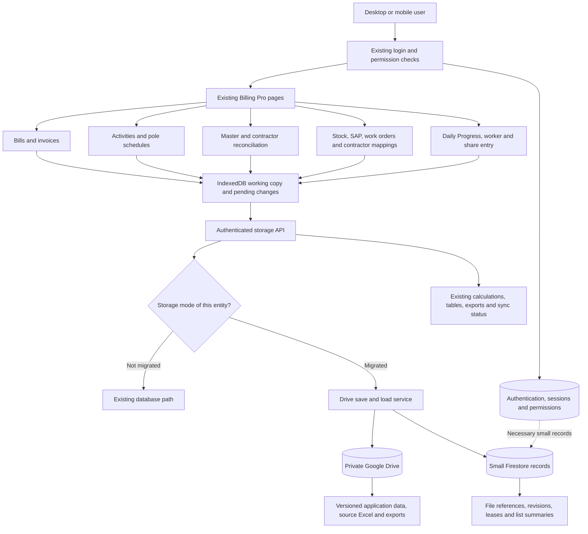
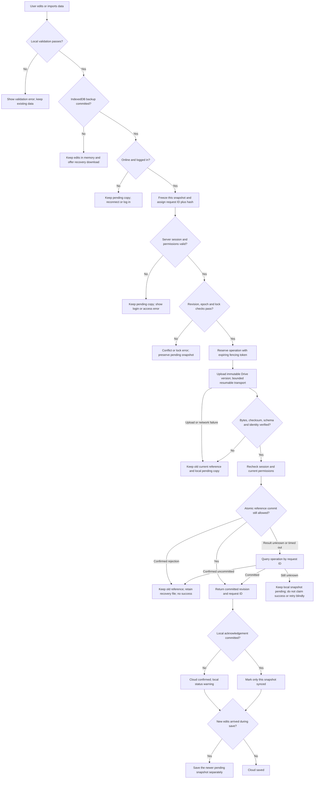
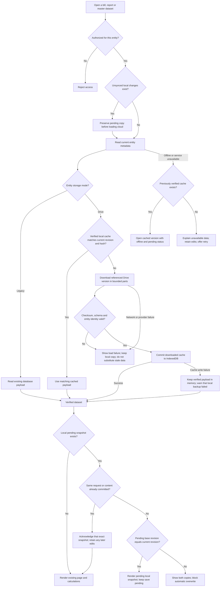
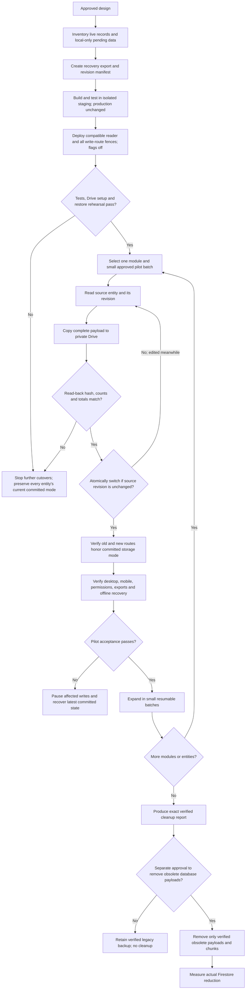
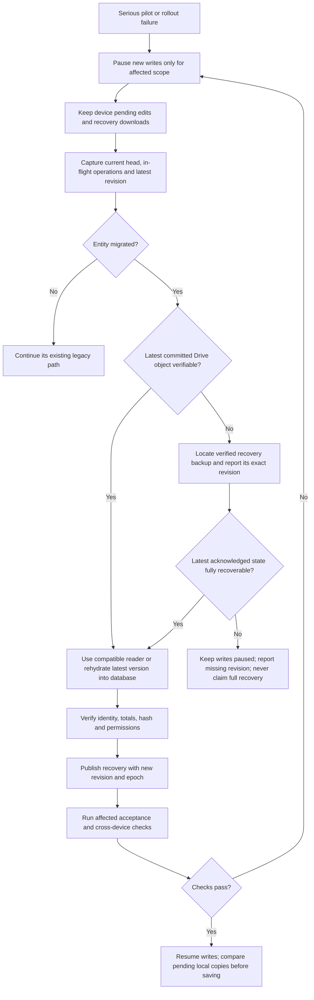

# Billing Pro storage flowcharts and two-pass design review

Date: 18 November 2026, Asia/Kolkata

Scope: every Billing Pro business module. Companion plan:
[DRIVE_FIRST_STORAGE_PLAN.md](DRIVE_FIRST_STORAGE_PLAN.md).

Status: proposed design, not implemented. These diagrams describe the intended
system. The reviews below are source-code inspection and failure-scenario analysis,
not evidence that the future implementation has already passed runtime tests.
Only planning documents were changed during this review.
Reviewed application baseline: Git commit `71418d4`.

## 1. Complete system and storage responsibilities

Important boundaries:

- Every page uses the same policy, but modules are migrated separately.
- Firestore keeps necessary security/coordination records. It is not emptied.
- JSON snapshots preserve editable state; Excel/PDF files are separate assets.
- Existing billing formulas, source dates, units, quantities, rates and page designs
  are outside this storage change.
- An entity has one authoritative current revision; no independent Drive-versus-
  database choice based on which happens to answer first.

## 2. Save flow, including every confirmation boundary

Additional error edges are described in section 6. No network write to Drive occurs
inside a Firestore transaction callback. The authoritative reference changes only
after the object is verifiable and the final database transaction succeeds.

If an import also promises to save the original Excel, both the original asset and
the parsed snapshot must be verified before that import is marked fully saved.
A retry uses the same operation identity rather than inventing another logical save.

## 3. Open, refresh, offline and second-device flow

Loading a page must not itself publish a cached snapshot over cloud data. Historical
bill snapshots continue referencing their original master/mapping versions. Saved
Bills listing reads compact metadata, not every Drive payload.
Offline cached access must obey the existing unlocked-device/session policy and
contractor restrictions; an offline cache is not a bypass for expired login or
revoked permissions. If fresh authorization is required, retain the pending data
without displaying protected content until login can be verified again.

## 4. Migration while existing work continues

Pilot order: Master Reco -> large masters and contractor mappings -> remaining
Daily Progress payload/history paths -> RA bills, invoices and measurement snapshots.
The policy applies to all modules; the cutover is intentionally incremental.

Original payloads must remain recoverable until verification and cleanup approval.
For legacy objects close to Firestore's document limit, a small new head record can
hold the storage marker while the unchanged original remains in a legacy namespace;
do not make the old document larger or destructively rewrite it merely to add a marker.
Every legacy write must check the authoritative storage mode in the same transaction
as its final mutation. A check performed earlier outside that transaction still races
with migration. These write fences must be deployed and tested before any cutover.

## 5. Rollback without losing newer work

Do not simply redeploy an old build that cannot understand Drive references. Do not
flip a flag to an old Firestore snapshot after users have made newer Drive saves.
Restoring an older backup without acknowledging missing newer changes is data loss,
not successful rollback. Drive versions are useful but not an independent disaster
backup for loss of the entire Google account; recovery policy must cover that too.

## 6. Failure-scenario walkthrough

This is a manual design walkthrough, not a production fault-injection test.

| Scenario walked through | Required outcome | Acceptance evidence needed before release |
| --- | --- | --- |
| LocalStorage full | IndexedDB snapshot can still save; unrelated browser data retained. | Existing baseline test plus new all-module paths. |
| IndexedDB transaction aborts | No cloud replacement; keep old persisted state and offer a download of in-memory edits. | Inject abort before and after UI update boundary. |
| Login or permission revoked mid-upload | Final commit rejected; pending data retained. | Revoke permission after operation reservation. |
| Two clients save revision 0 | Exactly one valid entity creation; loser cannot replace it. | Simultaneous first-create test. |
| Two clients save revision N | One commit succeeds; the other retains a conflict copy. | Parallel saves across separate server instances. |
| Operation expires during a long upload | Expired operation cannot commit after a newer operation starts. | Expire/renew lease and change fencing token during upload. |
| Network fails before Drive upload | No published reference or false success. | Disconnect before upload acknowledgement. |
| Drive creates file but response is lost | Retry resolves the preassigned operation/file identity. | Drop response and retry same request. |
| Drive succeeds; Firestore commit fails | Old committed head remains; new file retained for recovery. | Fail the final transaction explicitly. |
| Commit succeeds; browser loses response | Request-ID lookup acknowledges existing save; no extra logical revision. | Drop final response, then refresh/retry. |
| More edits arrive while saving | Acknowledge sent snapshot only; later edits remain pending. | Type after request starts but before response arrives. |
| Another client finalizes or deletes during save | Final commit rejects stale epoch/permissions; no resurrection. | Race finalize/delete with an upload. |
| Two concurrent deletes approach the last bill | Preserve the existing minimum-bill rule atomically at project level. | Parallel deletion of the last two live bills. |
| Old tab/mobile sends an old-format save after migration | Legacy route consults the authoritative storage mode; no competing database payload write. | Keep an old browser build open during pilot migration. |
| Source changes while migration copies it | Source-revision check fails; copy again without switching stale data. | Edit between copy and cutover. |
| Metadata and Drive hash disagree | No load or publication as current verified data. | Alter/truncate a test file. |
| Same contractor display name in different records | Stable contractor/work-order/project identities remain separate. | Duplicate-name and mapping-isolation fixtures. |
| Large upload succeeds but subsequent download is oversized | Bounded download reconstructs the same bytes on another device. | Upload and second-device reload above host body limit. |
| Shared stock/master changes after bill finalization | Historic bill stays pinned to its original snapshot. | Compare historic export before and after master update. |
| Contractor mapping save succeeds but bill save fails | No false all-saved result; bill snapshot explicitly pins the intended mapping version. | Partial multi-record save test. |
| Drive permissions or quota fail | Local pending data retained; bounded retry or setup error; no silent database payload fallback. | Real test-folder permission and quota/error simulation. |
| Drive file manually moved/deleted/modified | Identity/integrity check detects it; reference and recovery status reported accurately. | Use disposable test files only. |
| Browser reloads while local acknowledgement is failing | Cloud commit discoverable; pending status cannot trigger a blind stale overwrite. | Abort acknowledgement transaction, then reload. |
| Cleanup runs while another operation is in flight | Current heads, active operations, retained versions and backup manifests are protected. | Dry-run only in initial rollout; test reachability before any later cleanup. |

## 7. Review pass 1: data consistency and dependency review

Method: trace existing callers and required API contracts, then walk the proposed
save/read paths against those dependencies. This review did not change runtime code.

| ID | Finding | Plan correction / required gate |
| --- | --- | --- |
| R1-01 | Shared config APIs store security records as well as business data. | Explicit business-key allowlist; auth/session/revocation records remain separate. Contract-test login, expiry, reset and admin elevation. |
| R1-02 | Bill summaries currently derive fields from full payloads. | Verify compact list metadata before removing payloads; preserve bill-list API fields. |
| R1-03 | Finalized bills and active contractor mapping have different update semantics. | Pin bill snapshot/master versions; reuse mapping does not rewrite history. |
| R1-04 | Existing billing Firestore revision check is separate from its write. | Both normal saves and migration cutover require atomic revision/fencing checks, including creation. |
| R1-05 | Module feature flags alone cannot stop older clients and legacy bulk-update endpoints. | Every write endpoint, including `updateAllBillsPoleSchedules` / `updateAllBillsActivities`, must consult authoritative entity storage mode. Old routes cannot bypass migration fences. |
| R1-06 | Daily Progress has several full-payload/history paths in addition to its Drive path. | Migrate `dailyProgressData`, shared reports, base reports and event payloads while preserving location/token/worker permissions. |
| R1-07 | Independent Firebase/Mongo writable failover could create competing heads. | One coordination authority; explicit provider recovery instead of automatic split writers. |
| R1-08 | Bytes and references alone do not establish semantic consistency. | Validate schema, stable IDs, counts, source versions, quantities, units, totals and finalized status. |

Pass 1 result: design issues identified and incorporated into this proposed flow.
All implementation acceptance gates remain open until implemented and tested.

## 8. Review pass 2: interruption, rollout and recovery review

Method: walk success and failure branches independently of the happy path, including
old clients, operations spanning deployments, and rollback after new user saves.

| ID | Finding | Plan correction / required gate |
| --- | --- | --- |
| R2-01 | A long/resumed upload may outlive a reservation. | Operation renewals and fencing tokens; late attempts cannot publish an expired save. |
| R2-02 | Authorization at upload start may be obsolete at commit time. | Recheck session, permissions, finalized state and epoch at the final commit boundary. |
| R2-03 | Hard deletion removes revision evidence and can permit stale recreation. | Tombstones/epochs for migrated entities; enforce last-bill invariant transactionally if retained. |
| R2-04 | Rolling back a feature flag can lose newer Drive changes. | Compatible reader plus latest-version rehydration; no stale legacy fallback. |
| R2-05 | A valid backup of revision N does not recover a lost acknowledged revision N+1. | Report recovery-point accuracy; pause writes when exact latest state cannot be recovered. |
| R2-06 | Copying to Drive does not itself reduce Firestore storage. | Separate verified cleanup report and approval; protect references and active operations. |
| R2-07 | Small-file tests do not test the host body limit on reload. | Exercise large upload AND download, retry offsets, encoding overhead and Unicode boundaries. |
| R2-08 | Many small autosaves can grow versions and API usage even with small Firestore heads. | Debounce/coalesce pending saves, skip unchanged content, measure operation rates, and define retention separately. |
| R2-09 | Drive metadata and source Excel can finish at different times. | Publish an import only when all required asset references are verified; retain partial uploads as recoverable uncommitted objects. |
| R2-10 | Shared service changes can disturb modules even with migration flags off. | Run old-format API contract tests in staging with all flags off, then test one module enabled while all others remain legacy. |

Pass 2 result: the safe rollout must include these conditions; migration must stop
at a failed gate rather than expand to the rest of the application.

## 9. Protecting the working system

1. Implementation happens in a separate branch and isolated staging deployment.
   Production remains unchanged while compatibility code is developed and tested.
2. No UI/formula refactor is bundled with storage migration.
3. Test both feature-flags-off and mixed legacy/Drive operation before pilot cutover.
4. No global conversion of `getDefaultConfig`, no migration of authentication data,
   and no automatic deletion of original business payloads in the initial rollout.
5. Require before/after snapshots and exports for each pilot module, plus a real
   restore drill on disposable staging data.
6. Expand only after two-device acceptance; one failed invariant pauses that module.
7. Keep a known compatible rollback deployment, immutable recovery manifests and
   latest-head evidence. Do not rely only on a Git code rollback.
8. Produce a production change report identifying records switched, previous/current
   revisions, verified backups and pending operations, without exposing credentials.

## 10. What has been checked versus what has not

- DONE: two design-review passes documented above and 24 failure-scenario walkthroughs.
- DONE: all five diagram definitions passed Mermaid 12.3.0 syntax parsing in a
  temporary isolated tool directory. This checks diagram grammar, not rendered
  layout or correctness of an unimplemented storage system.
- DONE: repository call paths checked; special handling identified for auth,
  summaries, bulk writes, Daily Progress history, concurrency, delete and rollback.
- BASELINE FROM PREVIOUS PLANNING STEP: full `npm test` passed; health audit 11/11.
  Runtime code has not changed since those checks, so repeating the same suite would
  not prove the proposed migration works.
- NOT YET DONE: new storage implementation, staging tests, production Drive account
  and credentials verification, live inventory, multi-device pilot, or restore drill.
- CURRENT DECISION: ready for user review of the design; not ready to migrate live data.

The target is to keep existing behavior stable and make failures recoverable.
Two design reviews reduce overlooked risks; they do not guarantee zero future errors.

## 11. Additional recheck requested by the user

The storage diagrams were checked again before drawing the whole-project map.
Four missing or ambiguous branches were corrected in the diagrams:

1. An unknown database-commit result must be looked up by request ID. A timeout does
   not prove that the old head is still current, so blind retry is unsafe.
2. Local pending edits based on the current cloud revision must stay visible as the
   local working snapshot. Loading the same base revision must not erase those edits.
3. A valid downloaded dataset can be viewed in memory when its local cache write
   fails, with a visible warning. A provider read failure has an explicit error path.
4. Stopping a later migration batch preserves the already-migrated entities' current
   modes. It cannot truthfully promise that all production remains unchanged after
   earlier successful cutovers.

These are documentation corrections. Future implementation tests must cover each
branch; no production code was changed to implement them during this recheck.
